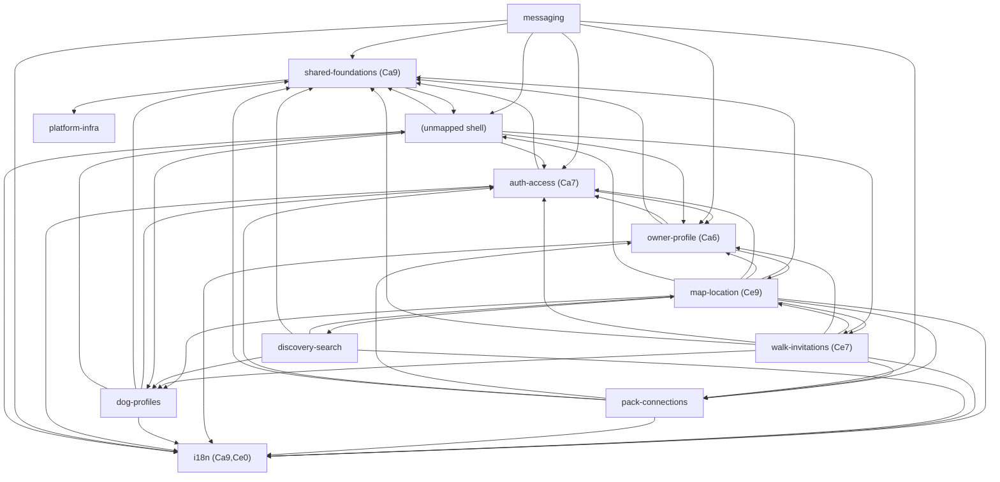

# Evidence: structure

Question: how far does a change in each capability reach, and where are its boundaries broken?
Scope: `src/**` tracked `.ts/.tsx/.astro` only (82 files). Supabase migrations/config, scripts, .github, context/docs are **not imported by TS** → no graph edges (unknown, not "no deps").

## Graph sources
| Language | Source | Level | Confidence | Blind spots |
|---|---|---|---|---|
| TS/TSX/Astro | rg/regex import+export-from+dynamic-import extractor (`.work/extract-edges.mjs`), `@/`→`src/` + relative resolved to real files | **4 (universal fallback)** | medium | re-exports counted as direct; runtime DI / Supabase RLS / cookie session coupling invisible; Astro↔component hydration edges only if `import`ed; migrations/SQL unlinked |
- `evidence`: 218 edges extracted, **0 unresolved**, all 82 files parsed. 187 runtime, 31 type-only.
- `evidence`: no graph tool installed (no madge / dependency-cruiser in deps or `.bin`; no graph npm script). tsconfig path alias `@/*→./src/*` confirmed.

## Capability graph (runtime, folded via capabilities.tsv)
12 nodes, 49 cross-capability runtime edges. 14 files unmapped (grouped) — the app chrome/nav shell: `src/components/{Banner,BottomNav,LangSwitcher,Topbar,Welcome}.astro` etc. (shared-foundations-class; capabilities.tsv has no prefix for root `src/components/*.astro`).

| Capability | Ca (depended-on) | Ce (depends-on) | Instability |
|---|--:|--:|--:|
| i18n | 9 | 0 | 0.00 |
| shared-foundations | 9 | 2 | 0.18 |
| auth-access | 7 | 3 | 0.30 |
| owner-profile | 6 | 4 | 0.40 |
| dog-profiles | 4 | 4 | 0.50 |
| pack-connections | 3 | 4 | 0.57 |
| map-location | 3 | 9 | 0.75 |
| walk-invitations | 2 | 7 | 0.78 |
| discovery-search | 1 | 4 | 0.80 |
| messaging | 0 | 6 | 1.00 (entry/leaf feature) |
| platform-infra | 1 | 0 | 0.00 (only reached via sentry-env/config-status) |
| (unmapped shell) | 4 | 6 | 0.60 |

## Blast radius per capability (HIGH-criticality)
- **auth-access** — the access hub. `src/lib/supabase.ts` imported by **23 files** (runtime); `src/middleware.ts` gates routes. A signature change to the Supabase client or session shape reaches 7 capabilities. Contract exported: `createSupabaseServerClient`, `locals.user` (via middleware).
- **owner-profile** — Ca 6. `src/lib/services/profile.ts` is pulled by auth (middleware), map, pack, messaging. Changing the profile service/row shape reaches auth + 3 features.
- **map-location** — Ce 9, the widest *outgoing* reach: `geo.ts`/`dogFilter` + consumes dog, profile, invitation, pack, auth. A change *here* is low blast-radius out (Ca 3) but it is the most fragile *consumer* — breaks easily when its upstreams change.
- **walk-invitations** — Ce 7, same pattern: heavy consumer, low fan-in.
- **dog-profiles** — Ca 4 via `breeds.ts`/`dogAttributes.ts`/`services/dog.ts` into discovery, map, shell.

## Cycles (runtime only)
- **File-level runtime cycles: 0** (`evidence` — graph-metrics on unfolded runtime edges: "None found"). There is **no real import loop anywhere in the codebase**.
- The 9-node *capability* cycle in the folded view is a **folding artifact**, not a loop. It is produced by 6 mutual capability pairs whose underlying files do not loop, e.g.:
  - shell↔shared-foundations: `Layout.astro`→`Banner.astro` vs `ChatThread.tsx`→`ui/button` (two different files).
  - discovery↔map: `OwnersMapView`→`dogFilter.ts` vs `dogFilter.ts`→`geo.ts`.
  - owner-profile↔auth: `ProfileForm`→`auth/FormField` vs `middleware.ts`→`services/profile.ts`.
  → `inference`: zero refactor-blocking cycles; treat the capability cycle as mechanical.

## Broken boundaries (`inference`: intended layering foundation→data→feature→entry)
- **middleware (auth-access entry) → owner-profile `services/profile.ts`**: entry layer reaching across into a feature's data service. Real cross-boundary edge, by design (middleware hydrates profile), but couples auth to the profile row shape.
- **map/[id].astro (map entry) → walk-invitations `services/invitation.ts`**: map page reaches into invitation service — feature-to-feature at the page layer.
- **ProfileForm (owner-profile) → map-location `geo.ts`** (3 edges) and **MeetingForm (walk) → geo.ts**: `geo.ts` behaves like a shared util living inside map-location; feature components reach into it. `inference`: `geo.ts` is mis-homed — a shared-foundation that sits under a capability prefix.
- Otherwise layering holds: features→auth/shared/i18n is downward (expected).

## Test risks
- **auth-access**: untestable in isolation — 23 importers pull `supabase.ts`; unit tests need Supabase client + cookie session mocked, else integration/E2E. (E2E already exists per repo notes.)
- **map-location / walk-invitations**: high Ce — a single component drags dog+profile+invitation+geo+auth; heavy mocking → prefer integration.
- **messaging**: Ca 0, Ce 6 — self-contained leaf feature, easiest to test in isolation (only consumes shared/auth/profile).
- **discovery-search**: `dogFilter.ts`→`geo.ts` is pure logic; unit-testable without a client.

## Centres and thin entry points
- **Load-bearing contracts (high Ca, low instability):** `src/types.ts` imported by **28 files** (shared-foundations, I0.x); `src/lib/i18n/index.ts` by **30 files** (i18n, Ca 9 / instability 0, a leaf); `src/lib/supabase.ts` by 23 (auth-access). These are **expected hubs — false-signal rule 2/mechanical, not risks**. A breaking change to `types.ts` or the i18n catalog keys is a strict-build-caught, cheap-coupling corridor.
- **Thin entry points:** `*.astro` pages mostly delegate to `src/lib/services/*` + React islands — the core logic is in services, not pages.
- Hub expectation from the brief (auth/supabase + shared/types) is **confirmed**.

## Mechanical signals
- **Type-only edges: 31** (kept separate per rule 9). Folded, they add one 2-node capability cycle (dog-profiles↔shared-foundations) — type-only, ignore.
- **Capability fold cycle (9 nodes):** artifact of mutual pairs, no file loop — mechanical.
- **platform-infra**: reached only via `sentry-env.ts`/`config-status.ts`; CI/scripts/config files have no import edges (config-as-code, rule 2).
- **i18n Ca 9 / shared-foundations fan-in** (Layout 18, utils.ts 9, ui/button 5): design-time hubs, rule 2 — not ranked.

## Unknowns
- Runtime coupling invisible to a static import graph: Supabase **RLS policies**, cookie/session flow, DB row-shape contracts across services, any dynamic `import()` of feature flags, SQL migrations↔service drift (migrations are not imported, so `supabase/*` is `unknown`, not disconnected).
- External consumers of the HTTP API routes (`/api/*`) — if any client lives outside the repo, it is `unknown (external)` (rule 10).
- Re-exports and barrel files may over-count a hub's fan-in (regex treats `export … from` as a direct edge).
- **Tool worth installing (level 3):** `dependency-cruiser` (adds resolved module graph + enforceable boundary rules in config) or `madge` (cycle detection + `--circular`); either would upgrade confidence from the regex fallback and let boundary rules be enforced in CI.

Commands run (this session): `node extract-edges.mjs > edges-ts.csv`; `graph-metrics.mjs edges-ts.csv --modules capabilities.tsv --kind runtime|type --unmapped group`; `graph-metrics.mjs … --kind runtime` (unfolded, 0 cycles); `graph-metrics.mjs … --emit mermaid`; `node cap-analysis.mjs` (mutual pairs + hub fan-in); `awk` counts for `supabase.ts`(23)/`types.ts`(28)/i18n(30) importers.
