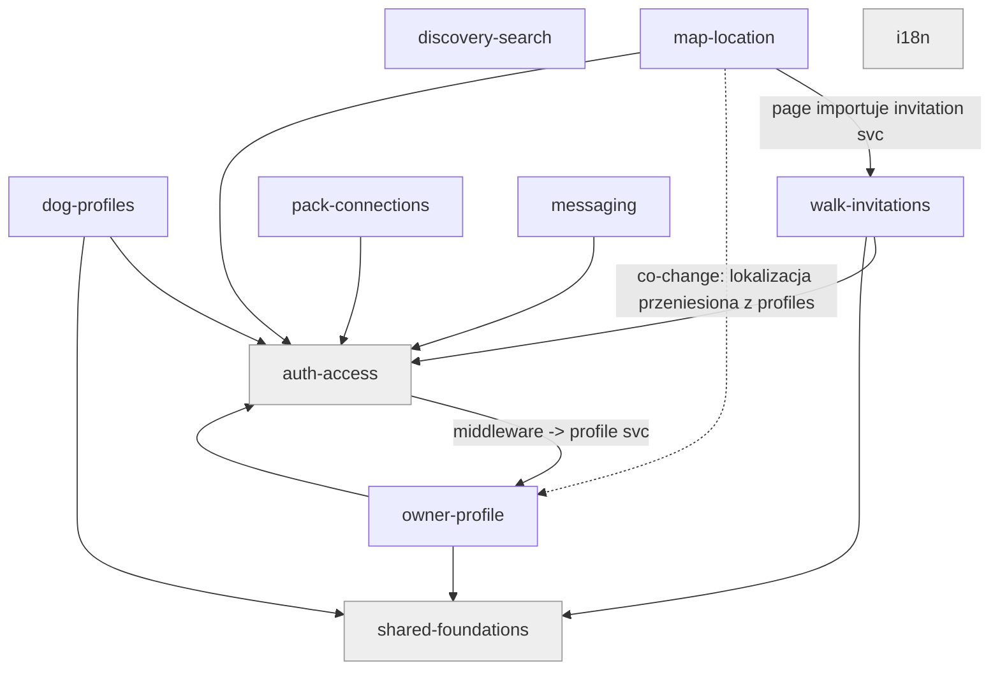

# Mapa projektu PawMeet — gdzie mieszka biznes i gdzie boli

## TL;DR

PawMeet to aplikacja webowa (Astro 7 SSR + React 19 + Supabase, deploy na Cloudflare Workers) dla właścicieli psów: umawianie wspólnych spacerów i budowanie grup psów (pack); w planach miejsca przyjazne psom i ciekawe miejsca na spacer, a szukanie partnerów do rozmnażania to dalszy horyzont (w kodzie tylko scaffold `type='breeding'`). Rdzeń wartości rozkłada się na kilka zdolności: **profile psów**, **discovery/filtrowanie**, **zaproszenia na spacer (maszyna stanów)**, **mapa + lokalizacja właściciela (prywatność)**, **pack (połączenia społeczne, consent)** i **wiadomości** — wszystko za bramką **auth/kontroli dostępu**. Najwięcej ruchu (zmiany + poprawki) koncentruje się w **map-location** i **walk-invitations**; to też jedyne miejsca z realnym ciśnieniem poprawek (24–28% commitów to fixy logiki/bezpieczeństwa, nie iteracja UI). Najszerszy zasięg zmiany ma **auth-access** (`supabase.ts` importowany przez 23 pliki, middleware bramkuje wszystko) — jest nośny, ale spokojny. Historia jest jednodniowa i jednoosobowa (1 człowiek, 0 botów/agentów jako autorzy), więc sygnały trendu i własności to baseline, nie findingi.

## Teren

Ranking: criticality × buzz. Buzz z niezależnych rodzin sygnałów (change / fix / friction / attention / reach).

| Zdolność | Co robi | Krytyczność | change | fix | friction | attention | reach | Gdzie żyje |
|---|---|---|---|---|---|---|---|---|
| **map-location** | Mapa + lokalizacja właściciela + prywatność lokalizacji | HIGH (wrażliwe dane / prywatność) | **high** (29 commitów/54 zmian — najwięcej) | **high** (24%, realne: foreign-read invariant, city-normalization, column-move) | **high** (PR #19≡#20 re-land, seria fixów UI, oba TODO z src tutaj) | **high** (~7 folderów zmian, motyw prywatności) | **high** (fan-out 9, instability 0.75) | src/pages/map, src/components/map, src/lib/geo.ts, migrations *location* |
| **walk-invitations** | Zaproszenia na spacer — maszyna stanów + zaplanowane spotkania | HIGH (dane użytkownika; core value; maszyna stanów) | **high** (25/42) | **high** (28%, realne: consent/RLS, błędy wysyłki zaproszeń) | med (impl-review triage) | **high** (7 folderów + jedyny audyt observability) | **high** (fan-out 7, instability 0.78) | src/pages/api/invitations, src/pages/meetings, src/lib/services/invitation.ts, src/components/meetings |
| **auth-access** | Login/signup/sesja, bramkowanie tras | HIGH (tożsamość/dostęp; inne zależą od niej) | med (17/42) | low (0%) | low | low | **high (mechaniczny hub)** supabase.ts→23, middleware bramkuje wszystko | src/pages/api/auth, src/pages/auth, src/middleware.ts, src/lib/{supabase,protected-routes}.ts |
| **owner-profile** | Podgląd/edycja profilu właściciela | HIGH (tożsamość / dane) | med (20/30) | med | low | med | med (fan-in 6) | src/pages/api/profile.ts, src/pages/profile.astro, src/lib/services/profile.ts, src/components/profile |
| **dog-profiles** | CRUD psów + atrybuty | HIGH (dane; core value) | med (12/32) | low (0%) | low | med | med (fan-in 4) | src/pages/api/dogs, src/pages/dogs, src/lib/services/dog.ts, src/lib/{dogAttributes,breeds,age}.ts |
| **discovery-search** | Filtrowanie/dopasowanie psów (rasa/rozmiar/cechy/wiek/dystans) | HIGH (core value) | low | tiny-n | low | med | med (instability 0.80) | src/lib/dogFilter.ts, src/pages/events |
| **pack-connections** | Połączenia właścicieli (pack), consent-gated | HIGH (dane; consent/RLS) | low (3) | tiny-n | low | low | low | src/pages/api/pack, src/pages/pack.astro, src/lib/services/pack.ts, src/components/pack |
| **messaging** | Czat właściciel–właściciel | MEDIUM (dane) | low (2) | tiny-n | low | low | low (fan-in 0) | src/pages/api/messages, src/pages/messages, src/lib/services/chat.ts |
| **i18n** | Katalogi PL/EN | MEDIUM (hub repo-wide) | med | — | low | low | **high (mechaniczny)** index.ts→30 | src/lib/i18n |

Kubełki poza-biznesowe: **shared-foundations** (design system, layouty, `types.ts`→28 importerów, utils) — nośny kontrakt, mechaniczny. **platform-infra** (CI, Sentry, config, scripts) — HIGH tylko w sensie „może ubić prod"; wolumen PR/fix zdemotowany jako iteracja CI. **docs-planning** (116 commitów) — szum workflow, nie sygnał produktu.

Pokrycie: ~35% zmian `unmapped` — niemal w całości tooling `.claude/` (147 plików), testy (30) i root config; udział produktu to drobny chrome (Topbar, dashboard, BottomNav/Banner). Footprinty biznesowe nie wymagają korekty. `src/components/*.astro` (shell nawigacji) nie ma prefiksu w capabilities.tsv — znane 14 plików unmapped.

## Realne powiązania

- **map-location ↔ owner-profile** — co-change support 9 (history) + runtime (inference ze struktury): lokalizacja przeniesiona z `profiles` do osobnej tabeli właściciela + RPC; middleware (auth) → profile service. Źródło: co-change + graf. *Nie mechaniczne.*
- **map-location → walk-invitations** — strona mapy importuje invitation service (krawędź cross-capability w grafie). Źródło: graf importów.
- **geo.ts źle „zadomowiony"** pod map-location — używany przez `ProfileForm` (owner-profile) i `MeetingForm` (walk-invitations). To współdzielony util udający część mapy. Źródło: graf. *Kandydat do przeniesienia do shared-foundations.*
- **auth-access/`supabase.ts` → 23 pliki**, **`types.ts` → 28**, **`i18n/index.ts` → 30** — kontrakty fan-in-by-design. Źródło: graf. **Mechaniczne** (false-signal reguła 2/3) — nie są ryzykiem same w sobie.

## Strefy ryzyka

Kwalifikują się dwie (HIGH krytyczność + high buzz w ≥2 niezależnych, niemechanicznych rodzinach):

1. **map-location** — najgorętsze i najbardziej wrażliwe miejsce w repo.
   - *Sygnały (niezależne):* change high (29/54) · fix 24% realny (foreign-read invariant, city-normalization radius, column-move prywatności) · friction (PR #19≡#20 re-land, seria `fix(ui-owners-map)`, oba TODO z `src/` tutaj) · attention (~7 folderów zmian).
   - *Gdzie żyje:* `src/components/map/`, `src/pages/map/`, `src/lib/geo.ts`, migracje `*location*`.
   - *Dlaczego ostrożnie:* prywatność lokalizacji to invariant bezpieczeństwa (foreign-read), już raz złamany i naprawiany; column-move złamał CI. Każda zmiana tutaj dotyka danych wrażliwych i RLS.

2. **walk-invitations** — maszyna stanów z realnym ciśnieniem poprawek.
   - *Sygnały (niezależne):* change high (25/42) · fix 28% realny (consent/RLS, błędy wysyłki) · attention (7 folderów + jedyny audyt observability wskazał ją pod kątem widoczności błędów) · reach (fan-out 7, instability 0.78).
   - *Gdzie żyje:* `src/lib/services/invitation.ts`, `src/pages/api/invitations/`, `src/components/meetings/`.
   - *Dlaczego ostrożnie:* przejścia stanów + reguły zgody; łatwo wprowadzić nielegalne przejście. **To ficzer wybrany na rdzeń researchu L3 + planu refaktoryzacji L4 + notatek DDD L5.**

**Watch (ocierają się o próg):**
- **auth-access** — nośny (supabase.ts→23, middleware bramkuje wszystko), ale spokojny: fix 0%, brak friction. Ryzyko = *zasięg*, nie *niestabilność*. Zmiana tu jest tania w napisaniu, droga w promieniu rażenia.
- **owner-profile** — sprzężony z map-location przez przeniesienie lokalizacji; traktować jako część tej samej strefy przy zmianach prywatności.

**Wygląda gorąco, nie jest:**
- `types.ts` / `i18n/index.ts` / `supabase.ts` wysoki fan-in — by design, mechaniczne.
- `docs-planning` 116 commitów — szum workflow.
- `platform-infra` wolumen PR/fix — iteracja CI/testów + spillover z map-location.
- messaging / pack / discovery wysoki % fixów — tiny-n (2–4 commity).
- 9-węzłowy „cykl" capability — artefakt zwijania 6 wzajemnych par; **0 realnych cykli plikowych** (potwierdzone plik po pliku).

## Kogo zapytać

Baseline: projekt jednoosobowy. **lmajers** (= lukasM / Uganda12LUK, ta sama osoba) jest autorem 100% commitów każdej zdolności; Claude występuje tylko jako `Co-authored-by` (69% commitów). Bus-factor **nie dotyczy** solo-projektu — pytać można tylko jedną osobę, o wszystko. Formalna/organizacyjna własność i aktualny skład zespołu są poza zasięgiem gita (unknown).

## Pierwszy dzień

Kolejność czytania (wszystkie ścieżki istnieją w HEAD 32daad6):

1. `src/middleware.ts` — brama auth; tu zaczyna się każdy request (bramkowanie tras).
2. `src/lib/supabase.ts` — hub importowany przez 23 pliki; klient SSR z sesją cookie.
3. `src/lib/services/invitation.ts` — logika maszyny stanów zaproszeń (rdzeń strefy ryzyka #2 i dalszego researchu).
4. `src/pages/api/invitations/respond.ts` — wejście przejścia stanu (accept/decline).
5. `src/lib/geo.ts` — współdzielony util dystansu/geo (źle zadomowiony pod mapą; dotyka prywatności).
6. `src/components/map/` — najgorętszy katalog UI; oba `TODO/FIXME` z `src/` tutaj.
7. `src/lib/dogFilter.ts` — rdzeń discovery (core value), filtrowanie po cechach/dystansie.
8. `src/types.ts` — kontrakt encji/DTO importowany przez 28 plików; czytać jako słownik domeny.

## Ograniczenia

- **Okno:** cała historia zsquashowana do **jednego dnia** (2026-10-16). Brak sygnału trendu czasowego — wszystkie 149 commitów to jeden kubełek. Analiza bazuje na wolumenie/fixach/co-change, nie na dynamice w czasie.
- **Źródła:** git + gh. Forge aktywny (issues #1–#14, PR #15–#24, wszystkie MERGED), ale **każdy PR ma 0 reviews i 0 komentarzy** — self-merge solo, więc ranking po gęstości review jest pusty wszędzie.
- **Pokrycie grafu:** TS/TSX/Astro 82/82 plików sparsowane regexem (fallback — brak madge/dep-cruiser). SQL (migracje/RLS), scripts, .github, config nie mają krawędzi importu = `unknown`, nie „brak zależności". Rekomendacja: zainstalować `dependency-cruiser` (reguły granic w CI) lub `madge --circular`.
- **Pokrycie capability:** ~35% zmian unmapped (głównie `.claude/` tooling + testy + root config); `src/components/*.astro` shell nawigacji bez prefiksu.
- **Czego mapa NIE mówi:** sprzężeń przez Supabase RLS/sesję/kształt wiersza (niewidoczne dla statycznego grafu); zewnętrznych konsumentów kontraktów (`unknown (external)`); pętla hodowlana (breeding, issues #6–#9) jest w PRD/issues, ale **nieobecna w kodzie** — czysty backlog `status:proposed`.
- **Unknowny warte pogłębienia (start dla /10x-research):** czy `types.ts` i schemat SQL trzymają się w zgodzie; czy invariant prywatności lokalizacji jest w pełni pokryty RLS; czy `geo.ts` powinien przejść do shared-foundations.
